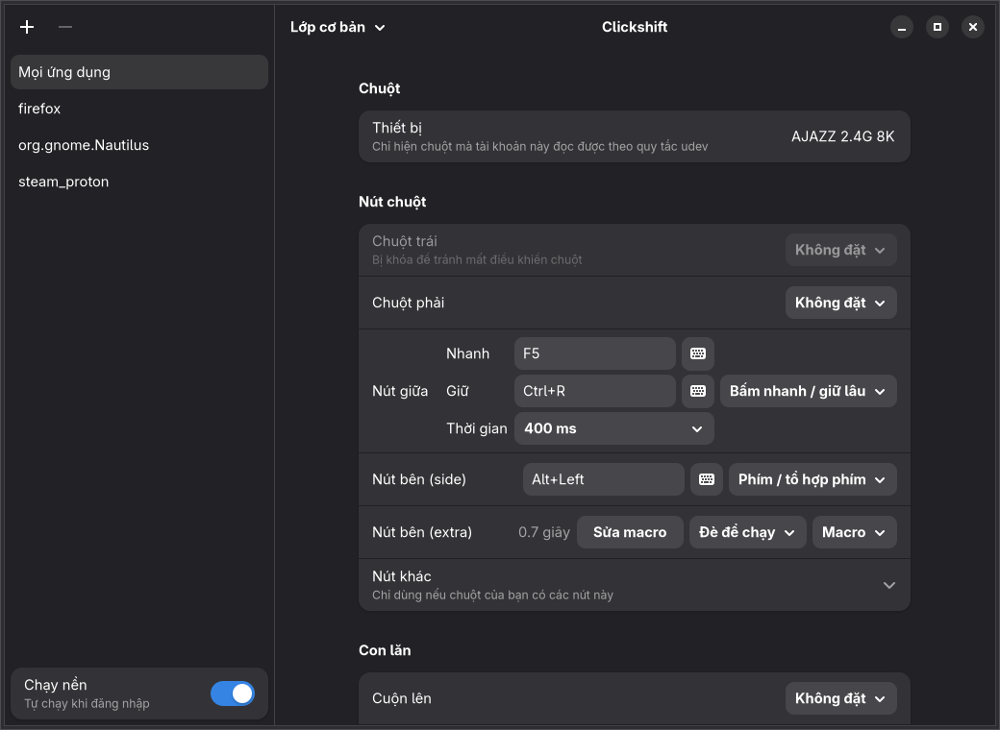
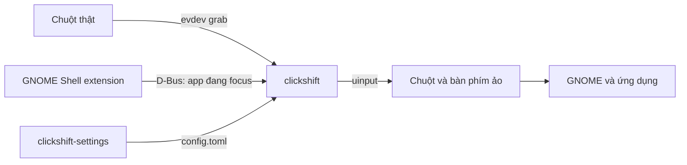

<div align="center">

# 🖱️ clickshift

**Gán lại nút chuột và tạo macro theo từng ứng dụng trên GNOME Wayland**

Chuyển sang app nào, chuột tự đổi theo thiết lập của app đó.




</div>

Lấy cảm hứng từ ý tưởng của X-Mouse Button Control trên Windows. Dự án được viết
lại hoàn toàn và không dùng chung mã nguồn với chương trình đó.

## ✨ Làm được gì

### Gán nút và con lăn

- 🎯 Đổi nút chuột thành phím, tổ hợp phím, phím media hoặc nút chuột khác
- 🖲️ Đổi hướng con lăn, hoặc biến mỗi nấc cuộn thành một phím
- 🚀 Chạy lệnh shell chỉ bằng một nút bấm
- 🚫 Tắt hẳn một nút, hoặc giữ nguyên chức năng gốc của nó

### Theo từng ứng dụng

- 🪟 Mỗi app có profile riêng, tự đổi khi bạn chuyển cửa sổ
- 🗂️ Nút không được đặt trong profile sẽ dùng thiết lập chung

### Thao tác nâng cao

- ⏱️ Bấm nhanh một việc, giữ lâu một việc khác
- 🤝 Bấm hai nút cùng lúc để kích hoạt hành động riêng
- 📌 Nút dính: bấm một lần để giữ, bấm lần nữa để nhả, tiện khi kéo thả
- 🧱 Thêm tối đa 9 lớp phím, dùng bằng cách giữ nút hoặc bật/tắt

### Macro có hẹn giờ

- 🎬 Ghi chuỗi phím và click kèm thời gian chờ chính xác đến từng mili giây
- 🔁 Ba chế độ chạy: đè để chạy, đè để lặp, bấm để chạy/dừng
- 🛟 Tự dừng và nhả mọi phím khi đổi cửa sổ hoặc mất kết nối chuột

### Ứng dụng cài đặt

- 🎨 Giao diện GTK 4 và libadwaita, không cần sửa file bằng tay
- ⌨️ Ghi phím bằng cách nhấn thật trên bàn phím
- 💾 Lưu là có hiệu lực sau khoảng 1 giây, không cần nút Áp dụng
- 🧾 Giữ nguyên comment trong file cấu hình và không lưu giá trị sai
- 🔌 Bật/tắt chạy nền ngay trong app

### Ổn định và an toàn

- ♻️ Tự kết nối lại khi rút rồi cắm lại chuột hoặc receiver
- 🧯 Kernel tự trả chuột khi chương trình kết thúc, kể cả khi bị crash
- 🔒 Quy tắc udev chỉ cấp quyền cho đúng con chuột bạn chọn, không cho đọc bàn phím
- 🛑 Chuột trái bị khóa mặc định để bạn không mất điều khiển

## ⚙️ Cách hoạt động



## 🎬 Macro

Viết macro theo cú pháp quen thuộc của X-Mouse Button Control:

```toml
[apps.steam_proton]
side = "macro-hold:e{WAITMS:300}{LMB}{WAITMS:150}{LMB}{WAITMS:250}{RMB}"
```

| Tiền tố | Cách hoạt động |
|---|---|
| `macro-hold:` | Chạy một lần khi đè, thả nút là dừng |
| `macro-repeat:` | Lặp liên tục khi đè, thả nút là dừng |
| `macro:` | Bấm để chạy, bấm lần nữa để dừng |

| Token | Ý nghĩa |
|---|---|
| `e`, `q`, `w` | Gõ phím thường, theo bố cục bàn phím US |
| `{LMB}` `{RMB}` `{MMB}` `{MB4}` `{MB5}` | Bấm chuột; thêm `D` hoặc `U` để nhấn hoặc nhả, như `{LMBD}` |
| `{WAITMS:160}` | Chờ 160 mili giây |
| `{MWUP}` `{MWDN}` `{MWLT}` `{MWRT}` | Cuộn một nấc |
| `{Enter}` `{F5}` `{Ctrl+C}` | Bấm phím hoặc tổ hợp phím |
| `{PRESS:Ctrl}` `{RELEASE:Ctrl}` | Nhấn giữ hoặc nhả một phím |

Token không có trong bảng sẽ bị từ chối kèm thông báo lỗi. Xem toàn bộ cú pháp cấu
hình trong [`config.example.toml`](config.example.toml).

> [!WARNING]
> Nhiều game online cấm macro tự động. Hãy kiểm tra điều khoản của game trước khi dùng.

## 📦 Cài đặt

Bạn cần Rust cùng thư viện phát triển của GTK 4 và libadwaita. Hãy chạy các lệnh
`sudo` trong terminal thật, vì chúng sẽ hỏi mật khẩu.

```sh
git clone https://github.com/1Tyson/clickshift.git
cd clickshift
cargo build --release --workspace
```

**1. Cấp quyền cho chuột.** Trước đó, hãy sửa tên chuột trong file quy tắc nếu bạn
dùng chuột khác. Dùng `target/release/clickshift list` để xem tên, hoặc `evtest` nếu
lệnh đó chưa thấy chuột.

```sh
sudo install -m 644 packaging/70-clickshift.rules /etc/udev/rules.d/
sudo udevadm control --reload
sudo udevadm trigger --subsystem-match=input --action=change
```

Nếu `clickshift list` vẫn không thấy chuột, hãy rút rồi cắm lại receiver.

**2. Tạo cấu hình.**

```sh
mkdir -p ~/.config/clickshift
cp config.example.toml ~/.config/clickshift/config.toml
```

**3. Cài GNOME extension.** Sau khi chép, hãy đăng xuất và đăng nhập lại rồi mới bật.

```sh
cp -r extension/clickshift@clickshift.github.io ~/.local/share/gnome-shell/extensions/
gnome-extensions enable clickshift@clickshift.github.io
```

**4. Cho chạy nền khi đăng nhập.**

```sh
install -D target/release/clickshift ~/.local/bin/clickshift
install -Dm 644 packaging/clickshift.service ~/.config/systemd/user/clickshift.service
systemctl --user daemon-reload
systemctl --user enable --now clickshift.service
```

**5. Thêm app cài đặt vào menu.**

```sh
install -D target/release/clickshift-settings ~/.local/bin/clickshift-settings
install -Dm 644 packaging/io.github.clickshift.Settings.desktop ~/.local/share/applications/io.github.clickshift.Settings.desktop
```

Đừng chạy clickshift cùng lúc với một preset của input-remapper trên cùng con chuột,
vì mỗi lúc chỉ một chương trình giữ được chuột.

## 🧪 Thử an toàn

```sh
target/release/clickshift list                     # xem chuột và các nút của nó
target/release/clickshift check                    # kiểm tra file cấu hình
target/release/clickshift run --dry-run --verbose  # chỉ in ra, không chiếm chuột
target/release/clickshift run --grab-seconds 30    # chạy thật rồi tự trả chuột sau 30 giây
```

## 🛠️ Kiểm thử

```sh
cargo test    # chỉ kiểm tra logic, không cần quyền gì
```

Bộ test đầu cuối chạy binary thật với một chuột ảo. Nó chiếm các thiết bị đầu ra
trước khi gửi tín hiệu, nên không có gì lọt ra desktop, và không đụng tới chuột thật.
Bộ test này cần thêm một quy tắc udev:

```sh
sudo install -m 644 packaging/71-clickshift-test.rules /etc/udev/rules.d/
sudo udevadm control --reload
cargo test --test e2e -- --ignored
```

## ⚠️ Giới hạn

- Mới chỉ được thử trên CachyOS với GNOME Shell 51 và Wayland.
- Profile theo app chỉ có trên GNOME; `metadata.json` hiện chỉ khai báo bản 51.
- Trên môi trường khác, mọi app sẽ dùng chung profile mặc định.
- Profile đi theo cửa sổ đang focus, không phải cửa sổ dưới con trỏ.
- Mỗi file cấu hình chỉ dùng cho một con chuột.
- Giao diện hiện chỉ có tiếng Việt.
- Ký tự trong macro giả định bố cục bàn phím US.
- Macro dừng khi đổi cửa sổ, nên không thể dùng macro để tự chuyển cửa sổ.
- Con lăn không dùng được macro, nút dính, lớp giữ hoặc bấm nhanh/giữ lâu.
- App cài đặt không mở khóa chuột trái; muốn đổi phải đặt `allow_left_remap` bằng tay.

## 📄 Giấy phép

Phát hành theo giấy phép [MIT](LICENSE).
