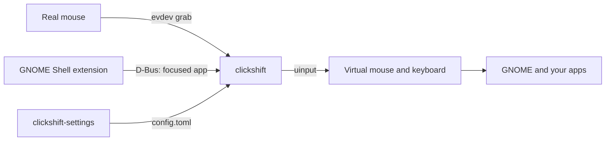
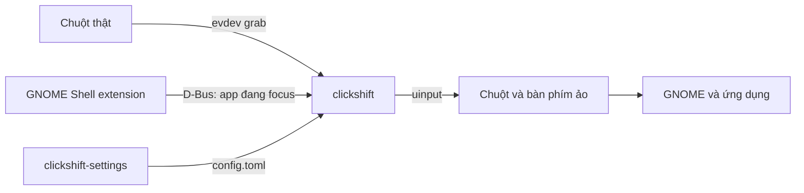

<div align="center">

# 🖱️ clickshift

**An X-Mouse Button Control-style app, rebuilt in Rust for GNOME on Wayland**

Remap mouse buttons and run timed macros, with different settings for each app.


**English** · [Tiếng Việt](#tieng-viet)


</div>

<a id="english"></a>

clickshift is a similar app to [X-Mouse Button Control](https://www.highrez.co.uk/downloads/XMouseButtonControl.htm)
on Windows, rebuilt from scratch in Rust to run on GNOME Wayland. It shares no code
with X-Mouse Button Control and is not affiliated with it.

## ✨ Features

### Buttons and wheel

- 🎯 Turn a mouse button into a key, a key combination, a media key or another mouse button
- 🖲️ Reverse the wheel, or make each wheel notch press a key
- 🚀 Run a shell command with one click
- 🚫 Disable a button, or leave it unchanged

### Per-app profiles

- 🪟 Give each app its own profile, which switches automatically with the focused window
- 🗂️ Anything a profile leaves out falls back to your general settings

### Advanced actions

- ⏱️ Do one thing on a quick click and another on a long press
- 🤝 Press two buttons together for a separate action
- 📌 Sticky buttons: click once to hold, click again to release, handy for dragging
- 🧱 Add up to 9 extra layers, used while a button is held or toggled on and off

### Timed macros

- 🎬 Chain keys and clicks with waits set in milliseconds
- 🔁 Three modes: play while held, repeat while held, or click to start and stop
- 🛟 Stops and releases everything when the focused window changes or the mouse disconnects

### Settings app

- 🎨 GTK 4 and libadwaita interface, so you never have to edit the config by hand
- ⌨️ Record a key by pressing it on the keyboard
- 💾 Changes apply within about a second, with no Apply button
- 🧾 Keeps the comments in your config and refuses invalid values
- 🔌 Turn the background service on or off from the app

### Stability and safety

- ♻️ Reconnects by itself when the mouse or its receiver comes back
- 🧯 The kernel returns the mouse whenever the program ends, even after a crash
- 🔒 The udev rule covers only the mouse you name, and does not expose your keyboard
- 🛑 The left button is locked by default, so you cannot lose control of the pointer

## ⚙️ How it works



## 📦 Install

You need Rust and the GTK 4 and libadwaita development files. On Arch or CachyOS:

```sh
sudo pacman -S --needed rust gtk4 libadwaita
```

Run every `sudo` command in a real terminal, because it asks for your password.

**1. Build it.**

```sh
git clone https://github.com/1Tyson/clickshift.git
cd clickshift
cargo build --release --workspace
```

**2. Give your user access to the mouse.** The rule is written for an `AJAZZ 2.4G 8K`,
so first change the name in `packaging/70-clickshift.rules` to match your mouse.
`sudo evtest` lists the names of your input devices.

```sh
sudo install -m 644 packaging/70-clickshift.rules /etc/udev/rules.d/
sudo udevadm control --reload
sudo udevadm trigger --subsystem-match=input --action=change
target/release/clickshift list
```

The last command should show your mouse. If it does not, unplug and replug the receiver.

**3. Create the config.** Set `name` under `[device]` to your mouse's name.

```sh
mkdir -p ~/.config/clickshift
cp config.example.toml ~/.config/clickshift/config.toml
```

**4. Install the GNOME extension.** It tells clickshift which app is focused. Copy it,
log out and back in, then enable it.

```sh
cp -r extension/clickshift@clickshift.github.io ~/.local/share/gnome-shell/extensions/
```

```sh
gnome-extensions enable clickshift@clickshift.github.io
```

## ▶️ Run it

**Try it first.** The first command changes nothing, and the second gives the mouse back
after 30 seconds.

```sh
target/release/clickshift run --dry-run --verbose
target/release/clickshift run --grab-seconds 30 --verbose
```

Press Ctrl+C on the keyboard to stop either one early.

**Keep it running.** This starts clickshift now and on every login.

```sh
install -D target/release/clickshift ~/.local/bin/clickshift
install -Dm 644 packaging/clickshift.service ~/.config/systemd/user/clickshift.service
systemctl --user daemon-reload
systemctl --user enable --now clickshift.service
```

**Open the settings app.** Start it directly:

```sh
target/release/clickshift-settings
```

To open it from the app menu instead, install it once and search for **Clickshift**:

```sh
install -D target/release/clickshift-settings ~/.local/bin/clickshift-settings
install -Dm 644 packaging/io.github.clickshift.Settings.desktop ~/.local/share/applications/io.github.clickshift.Settings.desktop
```

**Manage the service.**

```sh
systemctl --user status clickshift.service         # is it running?
journalctl --user -u clickshift.service -f         # follow its log
systemctl --user restart clickshift.service        # restart it
systemctl --user disable --now clickshift.service  # stop it and turn off autostart
```

After rebuilding, run the first `install` line above again and restart the service.

Do not run clickshift alongside an input-remapper preset on the same mouse, since only
one program can hold it at a time.

## 🎬 Macros

Macros use the familiar X-Mouse Button Control style:

```toml
[apps.steam_proton]
side = "macro-hold:e{WAITMS:300}{LMB}{WAITMS:150}{LMB}{WAITMS:250}{RMB}"
```

To add one in the settings app:

1. Pick an app on the left, or use **+** to add one.
2. Set a button to **Macro**, and choose how it plays.
3. Click **Sửa macro** (Edit macro), paste your macro, and click **Lưu** (Save).

| Prefix | Behavior |
|---|---|
| `macro-hold:` | Plays once while held, and stops when you let go |
| `macro-repeat:` | Repeats while held, and stops when you let go |
| `macro:` | Click to start, click again to stop |

| Token | Meaning |
|---|---|
| `e`, `q`, `w` | Type a key, assuming a US keyboard layout |
| `{LMB}` `{RMB}` `{MMB}` `{MB4}` `{MB5}` | Click; add `D` or `U` to press or release, as in `{LMBD}` |
| `{WAITMS:160}` | Wait 160 milliseconds |
| `{MWUP}` `{MWDN}` `{MWLT}` `{MWRT}` | Scroll one notch |
| `{Enter}` `{F5}` `{Ctrl+C}` | Tap a key or key combination |
| `{PRESS:Ctrl}` `{RELEASE:Ctrl}` | Press or release a key |

Tokens not listed here are refused with an error. Other X-Mouse Button Control tokens,
such as `{WAIT:1}`, `{WAITMS:10-20}` and `{CTRL}a`, are not supported yet. See
[`config.example.toml`](config.example.toml) for the full config syntax.

> [!WARNING]
> Many online games forbid automated macros. Check a game's terms before using one.

## 🧪 Tests

```sh
cargo test    # logic only, needs no permissions
```

The end-to-end suite runs the real binary against a virtual mouse. It grabs the output
devices before sending anything, so no input reaches the desktop, and it never touches
the real mouse. It needs one extra udev rule:

```sh
sudo install -m 644 packaging/71-clickshift-test.rules /etc/udev/rules.d/
sudo udevadm control --reload
cargo test --test e2e -- --ignored
```

## ⚠️ Limits

- Only tested on CachyOS with GNOME Shell 51 on Wayland.
- Per-app profiles need GNOME, and `metadata.json` lists Shell 51 only. Elsewhere, every
  app uses the default profile.
- Profiles follow the focused window, not the window under the pointer.
- One mouse per config.
- The settings app is in Vietnamese only for now.
- Macro characters assume a US keyboard layout.
- A macro stops when focus changes, so one cannot switch windows by itself.
- Wheel directions cannot use macros, sticky buttons, held layers or tap and hold.
- The settings app cannot unlock the left button; set `allow_left_remap` by hand.

## 📄 License

[MIT](LICENSE)

---

<a id="tieng-viet"></a>

# 🇻🇳 Tiếng Việt

[English](#english) · **Tiếng Việt**

clickshift là ứng dụng tương tự [X-Mouse Button Control](https://www.highrez.co.uk/downloads/XMouseButtonControl.htm)
trên Windows, được viết lại từ đầu bằng Rust để chạy trên GNOME Wayland. Dự án không dùng
chung mã nguồn và không liên kết với X-Mouse Button Control.

## ✨ Làm được gì

### Gán nút và con lăn

- 🎯 Đổi nút chuột thành phím, tổ hợp phím, phím media hoặc nút chuột khác
- 🖲️ Đổi hướng con lăn, hoặc biến mỗi nấc cuộn thành một phím
- 🚀 Chạy lệnh shell chỉ bằng một nút bấm
- 🚫 Tắt hẳn một nút, hoặc giữ nguyên chức năng gốc của nó

### Theo từng ứng dụng

- 🪟 Mỗi app có profile riêng, tự đổi khi bạn chuyển cửa sổ
- 🗂️ Nút không được đặt trong profile sẽ dùng thiết lập chung

### Thao tác nâng cao

- ⏱️ Bấm nhanh một việc, giữ lâu một việc khác
- 🤝 Bấm hai nút cùng lúc để kích hoạt hành động riêng
- 📌 Nút dính: bấm một lần để giữ, bấm lần nữa để nhả, tiện khi kéo thả
- 🧱 Thêm tối đa 9 lớp phím, dùng bằng cách giữ nút hoặc bật/tắt

### Macro có hẹn giờ

- 🎬 Ghi chuỗi phím và click kèm thời gian chờ chính xác đến từng mili giây
- 🔁 Ba chế độ chạy: đè để chạy, đè để lặp, bấm để chạy/dừng
- 🛟 Tự dừng và nhả mọi phím khi đổi cửa sổ hoặc mất kết nối chuột

### Ứng dụng cài đặt

- 🎨 Giao diện GTK 4 và libadwaita, không cần sửa file bằng tay
- ⌨️ Ghi phím bằng cách nhấn thật trên bàn phím
- 💾 Lưu là có hiệu lực sau khoảng 1 giây, không cần nút Áp dụng
- 🧾 Giữ nguyên comment trong file cấu hình và không lưu giá trị sai
- 🔌 Bật/tắt chạy nền ngay trong app

### Ổn định và an toàn

- ♻️ Tự kết nối lại khi rút rồi cắm lại chuột hoặc receiver
- 🧯 Kernel tự trả chuột khi chương trình kết thúc, kể cả khi bị crash
- 🔒 Quy tắc udev chỉ cấp quyền cho đúng con chuột bạn chọn, không cho đọc bàn phím
- 🛑 Chuột trái bị khóa mặc định để bạn không mất điều khiển

## ⚙️ Cách hoạt động



## 🎬 Macro

Viết macro theo cú pháp quen thuộc của X-Mouse Button Control:

```toml
[apps.steam_proton]
side = "macro-hold:e{WAITMS:300}{LMB}{WAITMS:150}{LMB}{WAITMS:250}{RMB}"
```

| Tiền tố | Cách hoạt động |
|---|---|
| `macro-hold:` | Chạy một lần khi đè, thả nút là dừng |
| `macro-repeat:` | Lặp liên tục khi đè, thả nút là dừng |
| `macro:` | Bấm để chạy, bấm lần nữa để dừng |

| Token | Ý nghĩa |
|---|---|
| `e`, `q`, `w` | Gõ phím thường, theo bố cục bàn phím US |
| `{LMB}` `{RMB}` `{MMB}` `{MB4}` `{MB5}` | Bấm chuột; thêm `D` hoặc `U` để nhấn hoặc nhả, như `{LMBD}` |
| `{WAITMS:160}` | Chờ 160 mili giây |
| `{MWUP}` `{MWDN}` `{MWLT}` `{MWRT}` | Cuộn một nấc |
| `{Enter}` `{F5}` `{Ctrl+C}` | Bấm phím hoặc tổ hợp phím |
| `{PRESS:Ctrl}` `{RELEASE:Ctrl}` | Nhấn giữ hoặc nhả một phím |

Token không có trong bảng sẽ bị từ chối kèm thông báo lỗi. Xem toàn bộ cú pháp cấu
hình trong [`config.example.toml`](config.example.toml).

> [!WARNING]
> Nhiều game online cấm macro tự động. Hãy kiểm tra điều khoản của game trước khi dùng.

## 📦 Cài đặt

Bạn cần Rust cùng thư viện phát triển của GTK 4 và libadwaita. Hãy chạy các lệnh
`sudo` trong terminal thật, vì chúng sẽ hỏi mật khẩu.

```sh
git clone https://github.com/1Tyson/clickshift.git
cd clickshift
cargo build --release --workspace
```

**1. Cấp quyền cho chuột.** Trước đó, hãy sửa tên chuột trong file quy tắc nếu bạn
dùng chuột khác. Dùng `target/release/clickshift list` để xem tên, hoặc `evtest` nếu
lệnh đó chưa thấy chuột.

```sh
sudo install -m 644 packaging/70-clickshift.rules /etc/udev/rules.d/
sudo udevadm control --reload
sudo udevadm trigger --subsystem-match=input --action=change
```

Nếu `clickshift list` vẫn không thấy chuột, hãy rút rồi cắm lại receiver.

**2. Tạo cấu hình.**

```sh
mkdir -p ~/.config/clickshift
cp config.example.toml ~/.config/clickshift/config.toml
```

**3. Cài GNOME extension.** Sau khi chép, hãy đăng xuất và đăng nhập lại rồi mới bật.

```sh
cp -r extension/clickshift@clickshift.github.io ~/.local/share/gnome-shell/extensions/
gnome-extensions enable clickshift@clickshift.github.io
```

**4. Cho chạy nền khi đăng nhập.**

```sh
install -D target/release/clickshift ~/.local/bin/clickshift
install -Dm 644 packaging/clickshift.service ~/.config/systemd/user/clickshift.service
systemctl --user daemon-reload
systemctl --user enable --now clickshift.service
```

**5. Thêm app cài đặt vào menu.**

```sh
install -D target/release/clickshift-settings ~/.local/bin/clickshift-settings
install -Dm 644 packaging/io.github.clickshift.Settings.desktop ~/.local/share/applications/io.github.clickshift.Settings.desktop
```

Đừng chạy clickshift cùng lúc với một preset của input-remapper trên cùng con chuột,
vì mỗi lúc chỉ một chương trình giữ được chuột.

## ▶️ Cách chạy

**Thử trước.** Lệnh đầu không thay đổi gì, lệnh sau tự trả chuột sau 30 giây. Nhấn
Ctrl+C trên bàn phím để dừng sớm.

```sh
target/release/clickshift run --dry-run --verbose
target/release/clickshift run --grab-seconds 30 --verbose
```

**Mở app cài đặt.** Sau bước 5 ở trên, nhấn phím Super rồi tìm **Clickshift**, hoặc chạy:

```sh
target/release/clickshift-settings
```

**Quản lý dịch vụ nền.**

```sh
systemctl --user status clickshift.service         # xem có đang chạy không
journalctl --user -u clickshift.service -f         # xem log
systemctl --user restart clickshift.service        # khởi động lại
systemctl --user disable --now clickshift.service  # dừng và tắt tự chạy
```

Sau khi build lại, chạy lại lệnh `install` của `clickshift` ở bước 4 rồi khởi động lại dịch vụ.

## 🛠️ Kiểm thử

```sh
cargo test    # chỉ kiểm tra logic, không cần quyền gì
```

Bộ test đầu cuối chạy binary thật với một chuột ảo. Nó chiếm các thiết bị đầu ra
trước khi gửi tín hiệu, nên không có gì lọt ra desktop, và không đụng tới chuột thật.
Bộ test này cần thêm một quy tắc udev:

```sh
sudo install -m 644 packaging/71-clickshift-test.rules /etc/udev/rules.d/
sudo udevadm control --reload
cargo test --test e2e -- --ignored
```

## ⚠️ Giới hạn

- Mới chỉ được thử trên CachyOS với GNOME Shell 51 và Wayland.
- Profile theo app chỉ có trên GNOME; `metadata.json` hiện chỉ khai báo bản 51.
- Trên môi trường khác, mọi app sẽ dùng chung profile mặc định.
- Profile đi theo cửa sổ đang focus, không phải cửa sổ dưới con trỏ.
- Mỗi file cấu hình chỉ dùng cho một con chuột.
- Giao diện hiện chỉ có tiếng Việt.
- Ký tự trong macro giả định bố cục bàn phím US.
- Macro dừng khi đổi cửa sổ, nên không thể dùng macro để tự chuyển cửa sổ.
- Con lăn không dùng được macro, nút dính, lớp giữ hoặc bấm nhanh/giữ lâu.
- App cài đặt không mở khóa chuột trái; muốn đổi phải đặt `allow_left_remap` bằng tay.

## 📄 Giấy phép

Phát hành theo giấy phép [MIT](LICENSE).
